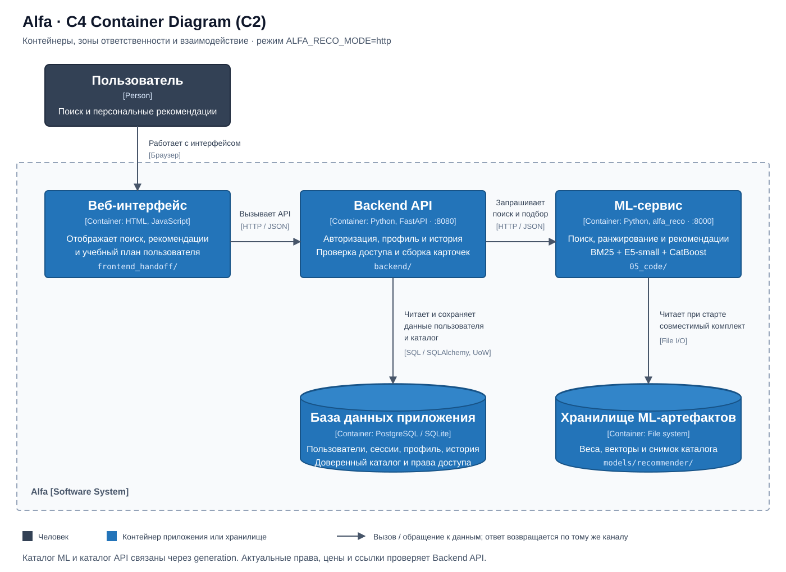

# Alfa — поиск образовательных материалов

Реализация и воспроизводимый запуск: [05_code/README.md](05_code/README.md).
Карта рабочих папок и локальных данных: [docs/WORKSPACE_LAYOUT.md](docs/WORKSPACE_LAYOUT.md).

Для локального смешанного каталога: `python3 demo_catalog/server.py --catalog data/demo_catalog.json --port 8767`, затем открыть http://127.0.0.1:8767. Подробности: [демо](demo_catalog/README.md), [данные](data/README.md). Для модели после клонирования нужны `git lfs install` и `git lfs pull`; инструкции — в [models/README.md](models/README.md).

## Запуск всего проекта одной командой

Для macOS/Linux нужны Docker Desktop, `uv`, Python 3, Node.js/npm и бэкап
`alfa_course_hackathon.backup` в корне. Если веса ещё не скачаны, нужен Git LFS.
Запускайте из корня репозитория:

```bash
# Первый полный запуск: явно разрешить SQL-миграцию новых таблиц API.
./run.sh --migrate

# Последующие запуски:
./run.sh
```

Скрипт восстанавливает PostgreSQL при первом старте, создаёт приватный env,
подготавливает Python 3.12 и зависимости, копирует модель в `models/runtime`,
запускает FastAPI с Python ML singleton и React/Vite. Исходники `05_code` не меняются.
Повторные запуски используют готовые зависимости и модель.

Открыть **http://127.0.0.1:5173**, API — **http://127.0.0.1:8080/docs**.
Логи: `.run/backend.log` и `.run/frontend.log`. Терминал остаётся занят;
Ctrl+C завершает API и Vite вместе с дочерними процессами. PostgreSQL остаётся работать.

Без `--migrate` SQL автоматически не выполняется. Если таблиц API пока нет,
скрипт остановится с подсказкой. Чтобы только установить зависимости и подготовить
модель, сохранив БД без новых таблиц:

```bash
./run.sh --prepare-only
```

Пароль и URL БД берутся из `backend/.env.snapshot`; существующий файл сохраняется.
ML-режим и generation скрипт выставляет автоматически из runtime модели.
Не запускайте одновременно контейнерный API на порту 8080: этот скрипт использует
Docker для PostgreSQL, а API с ML и Vite запускает нативно.
Подробности о снимке и SQL — [backend/SNAPSHOT.md](backend/SNAPSHOT.md).

## Архитектура: C4 Container (C2)



На схеме показаны контейнеры внутри границы системы Alfa и пользователь. Контейнер C4 —
это приложение или хранилище, а не обязательно Docker-контейнер. `frontend_handoff/` —
демонстрационный веб-клиент; подключение его к публичному API настраивается отдельно.

В запуске через `run.sh` бэкенд вызывает ML как Python-библиотеку; singleton загружает
веса один раз на процесс. Карточки читаются из восстановленного PostgreSQL, профиль
и история собираются на сервере. Отдельный ML-сервис по HTTP также поддерживается.

Связь включается через `ALFA_RECO_MODE=http` и `ALFA_RECO_URL=http://127.0.0.1:8000`.
В режиме `demo` используется демонстрационный алгоритм без обращения к ML-сервису.


- [Локальное обучение релевантности, NDCG и устойчивость](05_code/docs/RELEVANCE_TRAINING_2026-11-12.md).
- [Как обучена ML: источники, PairLogit, признаки и новый подбор весов](05_code/docs/ML_AND_SYNTHETIC_HOLDOUT_2026-11-12.md).
- [1000 сценариев + 120 сложных, результаты и локальный сайт](05_code/docs/CHALLENGE_1000_2026-11-12.md).
- [Аудит кода, модели, устойчивости и параметров BM25](05_code/docs/RANKING_AUDIT_2026-11-12.md).
- [Текущий алгоритм и математические ограничения](docs/ALGORITHM_SPEC.md).
- [Какие данные нужны для ML и как использовать синтетику](05_code/docs/ML_DATA_PLAN.md).
- [Независимая разметка](05_code/docs/ANNOTATION_GUIDE.md).

Исходная база и пользовательские данные остаются локально в исключённой из Git папке `05_code/artifacts/`. Совместимый комплект модели и демонстрационные данные входят в репозиторий; большой файл весов хранится в Git LFS. Офлайн-метрики по предварительной разметке не измеряют конверсию или прибыль.

Для интеграции с сайтом: [передача бэкенд-разработчику](05_code/docs/BACKEND_HANDOFF.md), [пример клиента](05_code/examples/backend_client.py). Модели и исходные данные находятся вне Git: для запуска потребуется безопасно передать совместимые артефакты.

Последние изменения алгоритма и формат метаданных: [памятка для бэкенда](05_code/docs/BACKEND_CHANGES_2026-11-13.md).

Для фронтенд-разработчика: [инструкция и тестовый стенд](frontend_handoff/README.md) на вымышленных данных. План развития коммерческих рекомендаций и учебного маршрута: [продажи и удержание](docs/ПЛАН_ПРОДАЖИ_И_УДЕРЖАНИЕ.md).
