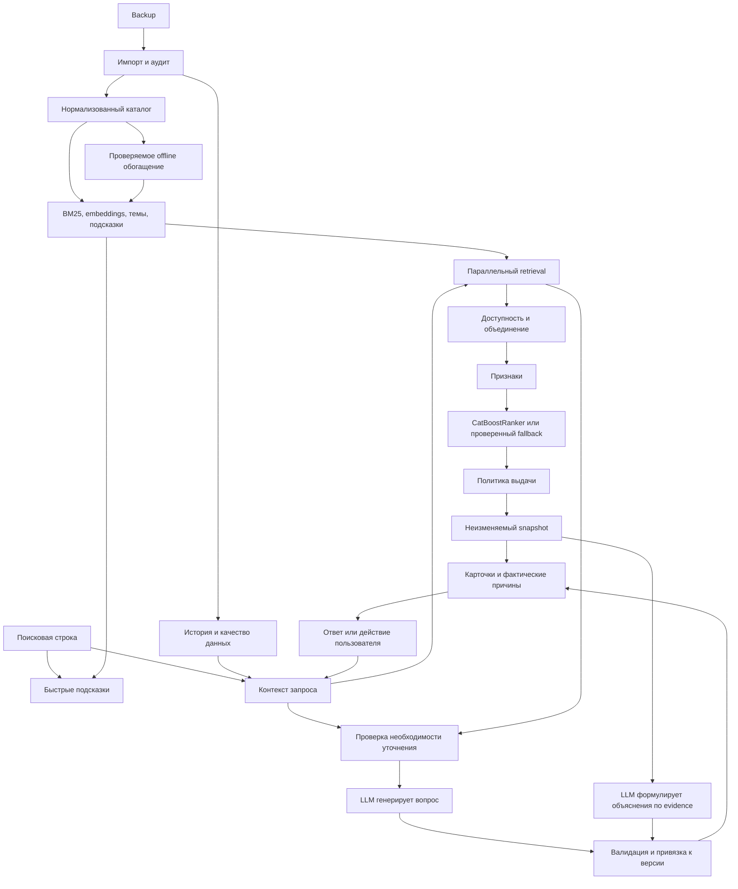
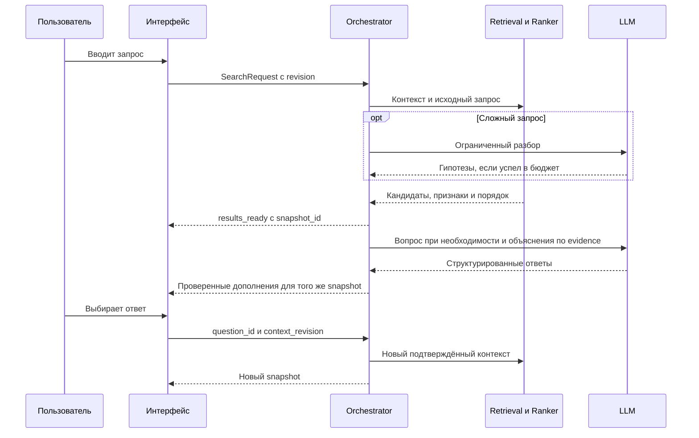

# Алгоритм персональных рекомендаций Альфа-Курса

Версия: 1.0. Дата: 11 ноября 2026 года.

**Статус:** техническая спецификация для реализации. Архитектурные решения зафиксированы; модели ещё не обучены, скорости и прирост качества не измерены. Проверка вариантов ниже — инженерный разбор, а не отчёт о проведённом ML-эксперименте. Числа по выгрузке — результаты ранее выполненного чтения всех 62 таблиц и проверки основных связей. Значения весов пока намеренно не назначены.

## 1. Цель и итоговый выбор

Создать систему, которая по свободному запросу, выбранным уточнениям и доступной истории рекомендует образовательные материалы: статьи, курсы, документы, подкасты, вебинары, инструменты и определения. Подборка должна помогать решить текущую задачу, учитывать состояние обучения, объяснять выбор и предлагать следующий шаг.

Основная бизнес-цель кейса — рост конверсии в покупку образовательных продуктов. Дополнительные цели — возвращаемость и вовлечённость. На предоставленной выгрузке проверяем релевантность, качество порядка и пользовательские сценарии. Рост покупок подтверждается будущим онлайн-экспериментом, а не выдуманной вероятностью оплаты.

**Выбранная архитектура:**

1. Подготовленный каталог с проверенными метаданными и происхождением полей.
2. Быстрые подсказки из каталога и заранее подготовленных поисковых формулировок.
3. Параллельный поиск по словам, смыслу, темам и истории.
4. CatBoostRanker для ранжирования кандидатов после подготовки разметки и проверки качества.
5. Контролируемая политика доступности, повторов, разнообразия и коммерческих предложений.
6. LLM для разбора сложных запросов, динамической генерации уточняющих вопросов и формулировки объяснений по доказательствам.
7. Выдача, которая работает без внешнего LLM API; вопросы и развёрнутые объяснения могут появляться позднее.
8. Версионированные результаты: запоздавшие ответы не меняют уже показанный порядок автоматически.

CatBoost — целевой обучаемый ранжировщик, а не декоративная часть. Если он не выигрывает проверку у гибридного поиска с прозрачными правилами, в демонстрации работает победившая версия. Результаты сравнения показываем честно.

## 2. Границы задачи

### Обязательно

- Свободный поиск без обязательной анкеты.
- Холодный старт, пустой запрос, неоднозначность, отсутствие точного материала.
- Смешанная выдача и явный поиск конкретного типа материала.
- Продолжение начатого обучения и рекомендации после завершения.
- Динамический необязательный вопрос с вариантами и свободным ответом.
- Объяснения на основе фактов каталога, контекста и трассы ранжирования.
- API, демонстрационный интерфейс, воспроизводимый запуск, офлайн-оценка.
- Управление временем ожидания, ошибками, обновлениями каталога и версиями результатов.

### Расширения после проверки основного пути

- Cross-encoder как дополнительная оценка релевантности пары «запрос — материал».
- Item-to-item рекомендации по совместному прохождению курсов.
- Подтверждённые редакционные связи из RecommendedItems.
- Учебный маршрут по проверенным связям и предпосылкам.

### Не является обязательной частью

- Telegram-бот и напоминания из другого трека.
- Полная копия сайта банка, банковская авторизация, эквайринг, Kubernetes.
- Обучение генеративной модели с нуля.
- Автоматическое дообучение по каждому клику.
- Обещание вероятности покупки, маржи или доказанного финансового эффекта.

## 3. Факты о данных и их влияние на алгоритм

| Проверенный факт | Решение |
|---|---|
| 62 таблицы, 102 128 строк | Импортировать воспроизводимо; сравнивать контрольные количества |
| 855 статей, 37 курсов, 508 уроков, 247 документов, 19 вебинаров, 8 подкастов, 351 термин, 7 калькуляторов | Единая карточка; уроки и инструменты обрабатываются с учётом типа |
| 1 148 из 1 166 карточек ContentSettings имеют темы; 1 095 — теги | Использовать темы и теги как сильные дополнительные признаки |
| Только 207 из 1 166 карточек имеют отрасли | Отсутствие отрасли не считать несовпадением |
| 10 050 связей пользователя с курсом, 7 342 пользователя, 29 курсов | История полезна, но покрывает только часть каталога |
| 5 780 пользователей имеют один курс; 1 105 — два; 457 — три и более | Контентный поиск обязателен; collaborative-сигнал не доминирует |
| Два курса дают 34,5% связей, пять — 59,5% | Ограничить влияние популярности, проверять разнообразие и длинный хвост |
| 1 266 строк с завершением курса; 982 пользователя хотя бы с одним завершением | Различать завершение, начало и простое наличие связи |
| 21 489 записей уроков, 4 976 связей с курсом, 304 урока | Продолжение строить через CourseLessonBindings |
| Проверенные ссылки пользователь—курс и пользователь—урок существуют; пары курс—урок согласованы | Связи пригодны для построения прогресса |
| LessonsCompleted расходится с количеством записей уроков в двух связях | Помечать конфликт; не выдумывать точный процент прогресса |
| 22 IsPaid=true, BuyingDate везде пустое | Не обучать достоверную вероятность покупки |
| Все пользовательские связи относятся к курсам типа «Открытый», включая 22 IsPaid=true | Значение IsPaid требует уточнения; не выводить из него entitlement или платность курса |
| В каталоге 32 «Открытых», 4 «По подписке», 1 «Платный» курс; Cost заполнен у одного | Разделять тип доступа, цену, право пользователя и неизвестные значения |
| 8 343 оценки; 7 033 пятёрки; UserId заполнен в 2 325 строках | Сглаживать рейтинг; не считать отсутствие оценки негативом |
| Оценки сопоставляются с уроками и калькуляторами | Не присваивать их автоматически статьям или курсам |
| Времена событий округлены до первого числа месяца, 12:00 UTC | Не моделировать точный порядок внутри месяца и дневной retention |
| 225 завершений курса и 9 624 завершения урока раньше Created | Время создания записи не считать безусловно временем действия |
| Поля Articles.Content и Lessons.Content пусты | Читать соответствующие EmbedItems, если использование содержания разрешено |
| RecommendedItems.CourseId полностью пустое; Id повторяется и часто совпадает с ID исходных материалов | Интерпретация Id → ItemId — гипотеза, включается отдельным флагом после проверки |
| В RecommendedItems есть самоссылка; 476 строк с Id не сопоставлены с проверенными основными сущностями | Не использовать неподтверждённые рёбра; убрать циклическое самопредложение |
| В backup не найден подтверждённый журнал поисковых запросов, показов и кликов | Подсказки строить по каталогу; свой журнал событий собирать отдельно |

Дополнительно: одинаковый UUID типа в разных таблицах нельзя автоматически трактовать одинаково. Например, идентификатор, соответствующий курсу в ContentSettings, в UserRatings встречается у EntityId уроков. Табличные адаптеры проверяют связи независимо.

Цифры отражают конкретный файл. При замене backup аудит повторяется. Идентификатор пользователя в истории — обезличенный ключ, а не доказательство стадии бизнеса, профессии или уровня знаний.

## 4. Словарь понятий

| Понятие | Смысл |
|---|---|
| Материал | Нормализованная единица каталога |
| Кандидат | Материал, найденный одним или несколькими методами |
| Контекст | Исходный запрос, уточнения, предпочтения и допустимая история |
| Facet | Ось уточнения: задача, формат, уровень, отрасль и т. п. |
| Evidence | Проверяемый факт с указанием источника, пригодный для объяснения |
| Retrieval | Поиск достаточно широкого списка кандидатов |
| Ranking | Упорядочивание кандидатов по полезности в данном контексте |
| Policy reranking | Ограниченное изменение списка по правилам продукта |
| Snapshot | Неизменяемая версия выдачи и контекста, на котором она построена |
| Inferred | Гипотеза правила или модели; не подтверждённый пользователем факт |
| Unknown | Значение неизвестно; не эквивалентно false, нулю или «бесплатно» |

## 5. Состав системы и ответственность

| Компонент | Получает | Возвращает | Не делает |
|---|---|---|---|
| DataImporter | Backup, схему и версии адаптеров | Таблицы и отчёт качества | Не публикует dump |
| CatalogBuilder | Таблицы, справочники, правила доступа | CatalogSnapshot | Не угадывает платность по отсутствию цены |
| HistoryBuilder | Связи курсов, уроков, оценки | HistorySnapshot и флаги качества | Не считает связь просмотром |
| IndexBuilder | Разрешённый текст каталога | BM25, vectors, topic/suggestion indexes | Не вызывает LLM на каждый будущий поиск |
| SuggestionService | Префикс, текущие фильтры, версия индекса | Подсказки и типы действий | Не утверждает, что это реальные популярные запросы |
| ContextResolver | Запрос, сессия, профиль, история | RequestContext | Не принимает LLM-гипотезу за hard constraint |
| QueryUnderstanding | Безопасный текст и краткий контекст | Гипотезы задач, span-ссылки, возможная неоднозначность | Не назначает курсы и цены |
| CandidateService | Контекст, индексы, профиль интересов | CandidateSet | Не формирует маркетинговые обещания |
| EligibilityService | Материал, доступ, ограничения | Решение и reason_code | Не трактует NoIndex как запрет показа |
| FeatureBuilder | Контекст и кандидаты | FeatureMatrix, evidence | Не использует будущие события |
| Ranker | Матрица, модель | Скоры, базовый порядок | Не возвращает вероятность покупки |
| PolicyReranker | Базовый порядок, доступ, правила | Финальный порядок, журнал перестановок | Не смешивает цену с сырым CatBoost score |
| ClarificationPlanner | Контекст, краткая картина кандидатов | Нужен ли вопрос, зачем и по какой оси | Не показывает бесконечную анкету |
| LLMQuestionWriter | Контекст и основания для вопроса | Один вопрос, варианты, mappings | Не меняет профиль без ответа пользователя |
| EvidenceBuilder | Признаки, факты, трасса policy | ExplanationEvidence | Не выдаёт SHAP за причинность покупки |
| LLMExplainer | Evidence и фиксированный snapshot | Текст объяснений с evidence_refs | Не меняет порядок, URL и карточки |
| Orchestrator | HTTP-запрос и версии состояния | Snapshot и поток дополнений | Не допускает устаревшие обновления |
| EventService | Подтверждённые UI/backend события | Идемпотентный журнал и обновление истории | Не считает отправленную карточку просмотренной |
| Evaluation | Разметка, версии моделей, тестовые контексты | Метрики, срезы и решение о выпуске | Не называет синтетический эффект ростом продаж |

## 6. Архитектура



Реализация на хакатон: один Python-сервис с модулями, PostgreSQL для данных и сессий, локальные индексы и файлы моделей, простой web UI. Тяжёлые локальные расчёты выполняются вне event loop. Отдельный GPU/worker допустим только если измерения покажут необходимость. Redis, отдельная векторная БД и очередь не обязательны; интерфейсы позволяют добавить их позже.

LLM вызывается через заменяемый адаптер провайдера с таймаутом, бюджетом и строгим форматом ответа. Идентификатор выбранной модели и версия фиксируются в manifest после измерений; нельзя заранее обещать качество или задержку конкретного провайдера.

## 7. Подготовка данных от backup до индекса

### 7.1. Импорт

1. Проверить наличие и хеш backup; импортировать в изолированную локальную БД.
2. Зафиксировать версии PostgreSQL/pg_restore и адаптеров.
3. Пересчитать таблицы, проверить schema drift и обязательные поля.
4. Сверить ключи, дубликаты, orphan-ссылки, статусы, даты, пустые значения.
5. Сохранить агрегированный отчёт без пользовательских строк, IP и закрытого содержания.
6. При критическом изменении схемы остановить сборку нового индекса; прежняя рабочая версия остаётся доступной.

### 7.2. Нормализация

- Ключ: `entity_key = entity_kind + ':' + source_id`. Простого UUID недостаточно как универсального типизированного ключа.
- `ContentSettings.EntityId` связывается с таблицей соответствующего типа; темы и теги идут через ContentSettingsId.
- Текст очищается от HTML, script/style и служебных фрагментов; исходный текст остаётся только в защищённом хранилище.
- Ё/е, регистр, формы русских слов обрабатываются для lexical search; исходная строка сохраняется. Технические токены C++, .NET, React, ИП, УСН нельзя разрушать нормализацией.
- Исправление опечаток и раскладки предлагает альтернативу, сохраняя поиск по оригиналу. Нельзя молча заменять осмысленный термин.
- Единицы длительности приводятся к минутам только при уверенном разборе. Иначе сохраняется исходное значение и missing flag.
- Число Cost без подтверждённой единицы/семантики не становится автоматически надёжной текущей ценой.
- Относительный URL собирается только по подтверждённому правилу для типа. URL проверяется при сборке/по расписанию, не на каждом запросе.
- Внешний URL не открывается сервером по произвольной команде пользователя; ссылки каталога проходят allowlist и проверку назначения.
- `NoIndex` — отдельный флаг, не автоматический запрет рекомендации. `Published=null` не означает черновик: у документов дата пуста, но статус опубликованный.
- Повторяющиеся названия уроков не считаются дубликатами без родительского контекста. Близкие материалы разных форматов не схлопываются безусловно.

### 7.3. Доступность и права

Храним раздельно:

- `publication_status`: published / draft / archived / unknown;
- `commercial_type`: open / paid / subscription / unknown;
- `content_visibility`: public / restricted / unknown;
- `entitlement`: доступ конкретного пользователя — granted / denied / unknown;
- `recommendable`: допускается ли публичная карточка;
- `launchable`: может ли пользователь открыть само содержание;
- `price_state`: verified / unknown / stale.

У публичной платной карточки может быть `recommendable=true`, но `launchable=false`. Тогда показываем карточку и официальный CTA, не сам закрытый урок. При неопределённом `IsClosed` не выдаём содержание; допустимость публичной карточки проверяем отдельно. Unknown не равен бесплатному доступу.

`IsPaid`, `ContentAccess` и наличие CourseUserBindings сами по себе не дают права раскрывать закрытый текст. Окончательные правила доступа уточняются по документации данных.

### 7.4. Содержание и обогащение

Базовый индекс: название, разрешённое краткое описание, темы, теги, подтверждённая аудитория. Чанки разрешённых открытых текстов могут дополнять его. У урока добавляется контекст курса, группы и темы.

Поиск по чанкам возвращает ID материала; итоговые карточки агрегируются по материалу. Большое число чанков не должно само по себе повышать материал. Используем максимум/ограниченный набор лучших совпадений, а не сумму всех совпавших фрагментов. Зафиксировать агрегацию в версии индекса.

Для закрытых уроков по умолчанию индексируются только разрешённые публичные метаданные. Использование полного текста возможно лишь при подтверждённом разрешении и отдельном локальном индексе с контролем доступа; оно не является зависимостью основной архитектуры.

Offline LLM может предложить задачи, поисковые переформулировки, уровень и аудиторию. Каждая такая характеристика имеет `origin=model_inferred`, evidence и статус проверки. Неподтверждённые предположения используются как мягкие поисковые признаки, не как факты в объяснении и не как условия допуска. Генерируемые задачи не заменяют исходное название и описание.

### 7.5. История

- Связь пользователь—курс = наличие записи о доступе/обучении, а не доказанный просмотр или покупка.
- Прогресс формируется из проверенных записей уроков и структуры курса. Конфликт со счётчиком отмечается.
- Следующий урок ищется по CourseLessonBindings с учётом групп, Order, IsDeleted, IsClosed, ClosedUntil и правил прохождения. Не прибавляем единицу к UUID или произвольному номеру.
- Если порядок/доступ не определён, действие — «Продолжить курс» через подтверждённую страницу курса.
- Interest profile хранит несколько интересов/тем. Один средний вектор всей истории не должен смешивать, например, Frontend и управление персоналом.
- Отдельно хранятся course state и preference: завершение курса не доказывает экспертный уровень или желание изучать ту же тему всегда.
- Времена исходной выгрузки имеют точность month; новые собственные события — точность timestamp. Источники и точность не смешиваются молча.
- Демо-события маркируются synthetic, реальные события — actual; сохраняется возможность сбросить демо-профиль.

### 7.6. Индексы и версии

Единый `IndexBundle`: catalog_version, embedding_model_revision, preprocessing_version, feature_schema_version, lexical_index_version, enrichment_version. Все части переключаются атомарно.

Рассчитать векторы материалов заранее; в момент запроса рассчитывать только вектор запроса. Соблюдать формат query/document и нормализацию конкретной модели. Выбирать русскоязычно пригодную модель по локальному Recall/NDCG и задержке. Наличие модели в кеше или высокий внешний benchmark не доказывают качество на этом каталоге.

Для небольшого каталога начинаем с точного сравнения векторов в памяти; приближённый индекс добавляем при необходимости масштаба. Названия и описания не должны слепо обрезаться до потери существенной части. Лимиты токенов и чанкинг фиксируются в manifest.

## 8. Контракты данных между модулями

Поля ниже задают обязательную семантику; JSON-примеры иллюстративны, это не реальные ID пользователей или материалов. Реализация оформляет их в типизированные схемы с валидацией. Неизвестные значения передаются как null/unknown и missing flags, а не маскируются нулями.

### 8.1. CatalogItem

```json
{
  "entity_key": "article:example-1",
  "catalog_version": "catalog-v1",
  "title": "Пример названия",
  "public_description": "Разрешённое описание",
  "topic_ids": ["topic-example"],
  "tag_ids": [],
  "industry_ids": [],
  "format": "article",
  "duration_minutes": null,
  "commercial_type": "unknown",
  "publication_status": "published",
  "recommendable": true,
  "launchable": false,
  "price": null,
  "canonical_url": null,
  "parent_course_key": null,
  "metadata_provenance": {},
  "data_quality_flags": ["url_unverified"]
}
```

Такой объект может участвовать во внутреннем анализе; в пользовательскую выдачу попадёт только после всех проверок, включая допустимый следующий шаг. Не показываем кликабельную выдуманную ссылку, если canonical_url неизвестен.

### 8.2. SearchRequest

```json
{
  "session_id": "demo-session",
  "client_revision": 7,
  "query": "Хочу открыть кофейню и посчитать расходы",
  "mode": "search",
  "selected_topic_ids": [],
  "explicit_preferences": {
    "formats": [],
    "free_only": false,
    "max_duration_minutes": null
  },
  "top_k": 5,
  "context_revision": 3
}
```

Server устанавливает user_id/доступ по проверенной сессии. Пользователь не может получить чужую историю, просто подставив user_id в JSON. В локальной демоверсии разрешён переключатель специально подготовленных профилей с явным demo_mode.

### 8.3. RequestContext

Содержит raw_query, normalized_query, selected_topics, explicit_constraints, soft_preferences, intent_hypotheses, history_summary, missing_fields, language, data_precision, context_revision.

Каждое извлечённое значение имеет оболочку:

```json
{
  "field": "business_stage",
  "value": "planning",
  "origin": "model_inferred",
  "evidence_span": "хочу открыть",
  "confirmed": false,
  "confidence_kind": "uncalibrated_model_estimate"
}
```

Приоритет: последнее явное исправление пользователя → явный ответ/выбор текущей сессии → сохранённое явное предпочтение → наблюдаемая история → гипотеза модели. История не отменяет текущую задачу. Противоречащие явные ограничения требуют уточнения; не выбираем одно молча.

### 8.4. Candidate

`entity_key`, `sources`, `source_ranks`, `source_scores`, `matched_intent_ids`, `retrieval_evidence`, `eligibility`, `missing_source_flags`. Храним отсутствующий score отдельно от реального нуля. Дубликаты объединяются по entity_key, источники сохраняются.

### 8.5. RankedCandidate

`entity_key`, `feature_schema_version`, `model_version`, `ranker_raw_score`, `base_rank`, `final_rank`, `policy_changes`, `eligibility_reason`, `evidence_refs`. Raw score не имеет единицы «вероятность покупки» и не сравнивается безусловно между разными запросами/моделями.

### 8.6. RecommendationSnapshot

`request_id`, `snapshot_id`, `context_revision`, `client_revision`, `catalog_version`, `model_version`, `ranker_mode`, `items`, `coverage`, `degraded_components`, `created_at`, `expires_at`.

Coverage: exact / partial / none / unknown, с основанием. Нельзя объявлять exact только потому, что какой-то материал оказался первым. Для многозадачного запроса хранится coverage по отдельным задачам.

В UI-ответе item содержит карточку, безопасную ссылку, access_label, CTA, короткие evidence-причины. Скоры доступны только в диагностическом режиме; основной пользователь не получает фиктивные проценты соответствия.

### 8.7. Clarification

`question_id`, `request_id`, `context_revision`, `snapshot_id`, `question`, `options`, `allow_free_text`, `can_skip`, `reason_code`, `expires_at`.

Каждый option: option_id, label, context_patch, supported_entity_keys либо `coverage=unknown`. Patch валидируется сервером. Выбор пользователя не является командой выполнить произвольный JSON от LLM.

### 8.8. Answer

```json
{
  "question_id": "question-example",
  "context_revision": 3,
  "option_id": "costs",
  "free_text": null,
  "skip": false,
  "idempotency_key": "answer-example"
}
```

Передаётся один из вариантов: option_id, free_text или skip. «Другое» открывает свободный ответ, не превращается в фиктивную тему. Новый контекст строит сервер, затем создаёт новый request_id/snapshot_id.

## 9. Подсказки во время ввода

Три типа ответа SuggestionService:

1. `material`: перейти к найденной карточке.
2. `topic`: выбрать тему без потери исходного текста.
3. `query`: заменить/дополнить строку конкретной поисковой формулировкой.

Пустая строка: разнообразные стартовые направления из актуального каталога, при известной истории — отдельно продолжение обучения. Префикс: lexical/prefix lookup по названиям, темам, синонимам и проверенным offline формулировкам. Полный запрос: дополнительно semantic lookup по словарю подсказок, если укладывается в бюджет.

Внешняя LLM не вызывается на каждое нажатие клавиши. Используются debounce, отмена предыдущего запроса, client_revision и ограничение частоты. Не начинать поиск во время незавершённой IME-композиции. Ответ для старой строки отбрасывается.

Подсказка имеет происхождение и поддержку каталогом. Не называем её «популярной», если нет журнала частот запросов. Семантически близкие формулировки объединяются, предлагаются разные полезные направления. Не создаём сотни вариаций для одного материала, которые вытеснят остальных.

Отсутствие клика по подсказке не означает отказ от темы или неудачу поиска. Подтверждённым уточнением становится только выбор или свободный ответ.

## 10. Пошаговый online pipeline

### Шаг 0. Получение запроса

Проверить схему, длину, top_k, размер фильтров и версию сессии. Запрос на другом языке допускается в пределах возможностей модели; язык ответа следует языку пользователя. Логировать безопасные метаданные, не полный исходный ввод с потенциальными персональными сведениями.

### Шаг 1. Контекст и быстрый разбор

Получить доверенную историю и текущие ответы. Сохранить исходный текст и извлечь очевидные ограничения, включая отрицания: «не курс», «только бесплатно», «до 20 минут». Обрабатывать их как hard constraints только при явном и однозначном выражении. Неуверенный разбор — гипотеза.

В режиме пустого запроса используем профиль/продолжение/подборку, а не cosine для пустой строки. При явном новом запросе история остаётся вспомогательной.

### Шаг 2. Маршрутизация LLM

Условия подключения QueryUnderstanding: несколько задач, сложные ограничения, неоднозначные сущности, слабое покрытие исходным поиском. Пустота профиля сама по себе не требует LLM при ясном запросе.

Быстрый поиск по оригиналу начинается параллельно. Для сложного запроса установлен ограниченный бюджет ожидания разбора. Если валидный результат успел до заморозки snapshot, дополняем запрос и при необходимости выполняем ограниченный второй retrieval. Оригинальный канал поиска сохраняется: переформулировка LLM не заменяет запрос полностью.

Если разбор опоздал, он может помочь сформировать вопрос/предложение уточнения, но не переставляет опубликованные карточки. Изменение выдачи происходит после действия пользователя либо нового явно инициированного запроса. Число циклов анализа и retrieval ограничено.

### Шаг 3. Получение кандидатов

Параллельно запустить доступные источники: BM25, embeddings, темы/теги, историю, проверенные связи, резервный источник. Предварительно фильтровать по опубликованности и известной доступности, где возможно.

### Шаг 4. Объединение и окончательный допуск

Объединить по entity_key, сохранить происхождение и применить EligibilityService. Если фильтрация опустошила список, выполнить bounded backfill из следующих кандидатов тех же источников. Жёсткие ограничения пользователя не снимать молча.

Сохранять кандидатов из разных источников и разных задач. Кандидат для обязательного продолжения должен быть доступен; он не даёт права обходить фильтры.

### Шаг 5. Формирование признаков

FeatureBuilder вычисляет один и тот же контракт для обучения и serving. История берётся на зафиксированной ревизии. Признаки из будущих статусов, результатов ответа пользователя на ещё не показанный вопрос и итоговой позиции не используются.

### Шаг 6. Ранжирование

Проверить совместимость модели и признаков. Запустить принятый по результатам оценки CatBoostRanker. Если он недоступен или модель не прошла приёмку, применить версионированный fallback и пометить ranker_mode.

### Шаг 7. Политика выдачи

Сначала минимальная релевантность и ограничения, затем разнообразие и допустимые бизнес-приоритеты. Сохранить порядок до/после и причины изменений. При недостатке хороших результатов вернуть меньше top_k.

### Шаг 8. Публикация snapshot

Зафиксировать список. Вернуть карточки с безопасными CTA и короткими фактическими причинами. Для слабой/частичной выдачи указать ограничение; не выдавать общую подборку за точное совпадение.

### Шаг 9. Асинхронные дополнения

ClarificationPlanner и LLMQuestionWriter при необходимости создают один вопрос. EvidenceBuilder и LLMExplainer формируют объяснения для уже показанных материалов. Обновления принимаются только при совпадении request_id, snapshot_id и context_revision.

### Шаг 10. Ответ пользователя

Проверить актуальность question_id. Применить подтверждённый patch, повысить context_revision и запустить новый поиск. Историю прежнего запроса хранить как контекст, но не как бессрочное жёсткое ограничение.

При skip не интерпретировать пропуск как негативный интерес, не повторять тот же вопрос. При смене темы сбрасывать локальные ограничения прежней задачи или явно предлагать их сохранить.

## 11. Генерация кандидатов и веса

### 11.1. Lexical retrieval

`L(q,i) = w_title * BM25_title + w_description * BM25_description + w_metadata * BM25_topics_tags`.

Это взвешенные полевые оценки; не называем реализацию BM25F, если её формула не реализована. Параметры BM25 k1/b и веса выбираются на validation. Нормализация, токенизация и stopwords версионируются. Отрицания и важные технические токены не удаляются бездумно.

### 11.2. Semantic retrieval

Базовый вариант — вектор полной публичной карточки. Исследуем отдельный вектор заголовка/чанков только через ablation. Сходство — определённая выбранной моделью функция, а не универсальная вероятность релевантности.

### 11.3. Темы и история

Явно выбранная тема, inferred-тема и исторический интерес — отдельные признаки/каналы. В общей рекомендации без запроса можно усилить историю. В поиске текущая задача приоритетнее старой истории.

Для построения интересов допускаются `w_history_binding`, `w_history_progress`, `w_history_completion`, `w_history_rating` и временное затухание. Это веса силы наблюдения, не денежной ценности. Пустые и конфликтные даты не создают фиктивной свежести. Recency по исходной выгрузке — только по месяцам и только для проверенного вида события.

### 11.4. Item-to-item и граф

Эксперимент item-to-item: совместные distinct user-course связи, нормализованная близость с минимальной поддержкой и shrinkage. Не использовать число уроков как множество независимых покупок курса. Сравнивать с простым content-based источником, не добавлять слабый канал только ради сложности.

Граф RecommendedItems: включается после подтверждения семантики, проверки обоих концов и ручной выборки. Исходный порядок рёбер — редакционный сигнал, а не prerequisite и не результат персонального ML. Self-edge удаляется. Недоступные концы не показываются; неопознанные источники карантинируются.

### 11.5. Слияние

Для источников с разными шкалами используем weighted RRF:

`RRF(i) = sum_s a_s / (k_rrf + rank_s(i))`.

Если источник не нашёл материал, его вклад отсутствует. Веса a_s относятся к источникам, а не к покупке. RRF помогает выбрать широкий набор для следующей стадии; исходные rank/score/missing передаются отдельно в CatBoost. Не складываем напрямую необработанные BM25, cosine и CatBoost.

Ограничения размера: N_source, N_union, N_rank; при наличии нескольких задач задаются минимальные квоты на поддержанные задачи и источники. Все значения определяются по candidate recall и задержке. Нельзя обрезать список так, чтобы один популярный тип вытеснил все документы/инструменты.

## 12. Признаки для CatBoost

| Семейство | Примеры | Что делать при отсутствии |
|---|---|---|
| Слова | BM25 по полям, точное название, покрытие терминов | source_missing отдельно |
| Смысл | card similarity, лучшая разрешённая chunk similarity | NaN + availability flag |
| Поисковые каналы | ranks, RRF, число источников, matched intent count | не подставлять «последнее место» без missing flag |
| Тема | выбранная тема, inferred-тема, пересечение тегов | неизвестно, не отрицательное совпадение |
| Запрос | длина, число задач, явные формат/время, неоднозначность | значения из текущего контекста |
| Профиль | подтверждённый формат, стадия, сфера; происхождение | categorical unknown |
| История | начал/завершил, проверенный прогресс, сходство с отдельными интересами | history_available=false |
| Материал | тип, длительность, пропуски, проверенная доступность | missing flag |
| Качество | сглаженный рейтинг по подходящей сущности, поддержка | неизвестно; отсутствие оценок не штраф само по себе |
| Популярность | log-support, сглаженная популярность в сопоставимом типе | не считать статьи непопулярными из-за отсутствия логов |
| Дополнительные | проверенная graph affinity, item-to-item, cross-encoder score | отдельная модель/профиль для доступного набора |

Стадию и уровень материала нельзя использовать как подтверждённое совпадение без разметки с provenance. Деньги не являются label. ID пользователя, его IP, raw UUID материала и административные поля не включаем как признаки для запоминания небольшого каталога.

Для рейтинга возможна сглаженная оценка `Q = (n * mean_rating + m * prior_mean) / (n + m)`. Prior и m оцениваются на train в сопоставимой группе; сохраняются n и missing flags. Оценки уроков не превращаются в оценку курса без явно проверенной агрегации. Весь этот канал проверяется ablation.

Cross-encoder не обязателен в первом релизе. При включении он читает пару query/public material и даёт дополнительный relevance feature. Значение не объявляется вероятностью. Полный кандидатный пул ограничивается; модель с этим признаком и fallback без него валидируются отдельно, а не заменяют пропуск произвольным нулём.

## 13. Обучение CatBoostRanker

### 13.1. Постановка

Обучаем порядок полезности материалов для конкретного поискового/рекомендательного контекста. Единица группы — `query_context_id`: запрос, ревизия профиля и доступная на этот момент история. Одна строка обучения — контекст + кандидат + признаки + оценка релевантности.

Базовая цель обучения: `CatBoostRanker` с `PairLogit` на числовых оценках 0–3 и group_id. Альтернатива `YetiRank` сравнивается как отдельный эксперимент. Не обучаем бинарную «покупку» по 22 сомнительным записям. Объективы и поддержку CPU/GPU проверяем для зафиксированной версии библиотеки.

По документации CatBoost пары можно строить внутри групп из различающихся числовых labels. Это соответствует нашей группировке контекстов. [Официальная документация ranking](https://catboost.ai/docs/en/concepts/loss-functions-ranking).

### 13.2. Разметка

Основной источник — независимые человеческие оценки:

- 0: не отвечает задаче/явно противоречит запросу;
- 1: частично связан, но плохо помогает;
- 2: полезен и соответствует задаче;
- 3: очень подходящий материал для данного контекста.

Недоступные по hard constraints материалы проверяются в отдельном наборе policy; не нужно учить модель игнорировать обязательные фильтры.

Плановый старт: порядка 150–250 разнообразных контекстов и 15–30 кандидатов на контекст, если ресурсы команды позволяют. Это оценка объёма ручной работы, не гарантия достаточности для обучения. Можно начать меньше, измерить кривую обучения и расширять слабые группы. Набор должен включать несколько тем и разные переформулировки, а не сотни почти одинаковых вопросов о кофейне.

Пул для разметки: BM25 + dense + темы + history + случайные допустимые материалы + трудные отрицательные примеры. Порядок перемешивается, автор разметки не видит score и источник алгоритма. Неоценённый кандидат имеет label=unknown и не становится автоматически нулём.

Часть контекстов независимо размечают два человека; расхождения обсуждаются. Фиксируем инструкцию, версию и согласие оценщиков. LLM может подготовить черновики запросов и кандидатов, но human gold test не размечается только той же моделью, которую оцениваем.

### 13.3. История и синтетические профили

Стартовый Ranker обучаем на ручной релевантности. Историческое предсказание следующего курса — отдельный benchmark и опциональный вспомогательный источник, а не обязательное смешивание labels.

Синтетические профили используются для разметки полезности в описанных сценариях и для функциональной демонстрации. Помечаем origin=synthetic, не называем их реальным поведением или ростом продаж. Real historical и synthetic метрики показываем раздельно.

### 13.4. Разделение

- Группы одного запроса/контекста не разрывать между train и test.
- Перефразировки, близкие шаблоны и ветки уточнений одного сценария держать в одном split по scenario_family.
- Для персонализации использовать отдельный срез с пользователями/профилями, отсутствующими в train; при пересечении семей и профилей группировать связанные сценарии вместе.
- Стабильный split, seed и хеши данных сохраняются.
- Feature transforms, статистика популярности, priors и гиперпараметры рассчитываются на train/validation, без test.
- После просмотра test нельзя продолжать выбирать веса на нём: нужны новый holdout или вложенная проверка.

### 13.5. Историческая проверка

События внутри одного месяца не упорядочивать произвольно. Формировать coarse monthly split только по полям с приемлемой семантикой; не использовать текущий IsCompleted как прошлое состояние. Каталог, редакционные связи и текущие статусы тоже могут содержать будущее: если прошлый snapshot недоступен, это явно ограничивает интерпретацию эксперимента.

Неизученные материалы без показов — unlabeled, а не доказанные отрицательные ответы. Из «прошёл после» нельзя заключить «купил благодаря рекомендации».

### 13.6. Выпуск

Ranker принимается по отложенной NDCG и критическим срезам, а также задержке и устойчивости. Bootstrap проводится по независимым семействам контекстов, не по отдельным строкам материалов. На маленькой выборке интервалы широки; не обещать статистически доказанное улучшение без соответствующего результата.

Сохраняются model artifact, feature schema, objective, параметры, split hashes, data provenance, package versions, validation report. Snapshot модели замораживается на время демонстрации. Новые клики не переобучают модель в процессе показа.

## 14. Fallback и полный реестр весов

### 14.1. Ранжировщик без обученной модели

Fallback необходим как сильный baseline и режим отказоустойчивости, а не как выдача случайных материалов.

`S_rule = weighted_mean(available normalized relevance signals) - applicable penalties`.

Сигналы: lexical, semantic, явная тема, формат, история, продолжение, сглаженное качество. Каждый сигнал приводится к сопоставимой шкале по train/validation либо используется rank-based fusion. Маска available учитывается при усреднении, но недостаток признаков не должен искусственно завышать score: отдельно сохраняется evidence_coverage и проверяется на missingness-срезах. Для разных режимов задаются согласованные профили весов, без скрытых правил на отдельные демо-запросы.

### 14.2. Где находятся веса

| Параметры | Этап | Назначение | Кто определяет |
|---|---|---|---|
| w_title, w_description, w_metadata | BM25 по полям | Значимость совпадения в каждом поле | Validation |
| a_lexical, a_dense, a_topic, a_history, a_graph | RRF | Баланс источников кандидатов | Candidate recall и validation |
| k_rrf | RRF | Чувствительность к позиции | Validation |
| w_history_binding/progress/completion/rating | Профиль интересов | Сила различных сигналов истории | Validation с контролем смещения |
| tau_history | История | Затухание по времени допустимой точности | Validation, не точные дни для исходного dump |
| w_rule_* | Fallback | Прозрачное базовое ранжирование | Validation |
| CatBoost parameters | Ranker | Деревья, регуляризация и взаимодействия признаков | Обучение и подбор на validation |
| m_rating | Сглаживание | Осторожность при малом числе оценок | Train/validation |
| b_base, b_diversity, b_business, b_repeat | Policy | Выбор внутри допустимой полосы релевантности | Продуктовый эксперимент + validation |
| delta_relevance, max_rank_shift | Policy | Ограничение ухудшения релевантности | Заранее заданный guardrail и validation |
| q_ambiguity, q_impact, q_missing, q_effort, q_repeat | Уточнение | Оценка полезности вопроса | Сценарная оценка/validation |

CatBoost не имеет одного глобального понятного коэффициента на каждый признак. Не добавляем второй раз те же ручные «веса истории» поверх его результата без отдельного обоснования: веса построения агрегата и вклад готового признака в модель — разные вещи.

Все числовые значения весов, порогов и квот пока не определены. Пример будущей конфигурации:

```yaml
retrieval:
  field_weights: {title: null, description: null, metadata: null}
  source_weights: {lexical: null, dense: null, topic: null, history: null}
  rrf_k: null
  source_limit: null
  union_limit: null
ranking:
  mode: selected_by_validation
  model_version: null
policy:
  commercial_boost_enabled: false
  business_weight: null
  diversity_weight: null
  max_rank_shift: null
clarification:
  ambiguity_threshold: null
  question_impact_threshold: null
  max_turns_per_intent: null
```

Это шаблон спецификации, не готовая рабочая конфигурация. Build validation обязан отклонять null у активных параметров. Для запуска выбирается конкретный проверенный профиль, а не произвольные значения по умолчанию.

## 15. Политика итоговой выдачи

### 15.1. Релевантность прежде бизнес-перестановок

Сырой CatBoost score нельзя складывать с ценой, cosine или произвольным business_score: шкала не калибрована между моделями и запросами.

Решение:

1. Сначала hard constraints и проверка минимальной релевантности. Gate настраивается по отдельно размеченным релевантным и нерелевантным парам; первый результат не становится релевантным автоматически.
2. Сохранить базовый порядок Ranker.
3. Для policy использовать ограниченную rank-based utility или отдельно валидированное нормирование. Эта utility задаёт порядок, не вероятность.
4. Переставлять только внутри допустимой полосы релевантности и ограничить смещение позиции.
5. При деградации ниже заранее принятого guardrail отключать business boost, а не скрывать ухудшение.

Пример целевой формы для последовательного выбора карточек:

`utility(i | selected) = b_base * base_utility(i) - b_diversity * max_similarity(i, selected) + b_business * eligible_offer_fit(i) - b_repeat * repeat_penalty(i)`.

Similarity для разнообразия должна лежать в определённой шкале. На первом шаге max_similarity=0. Ограничения релевантности и доступа действуют независимо от utility. При равенстве — стабильный детерминированный tie-breaker.

### 15.2. Коммерческая политика

В основном релизе commercial boost выключен до проверки полей и сценариев. Платные материалы всё равно могут быть первыми благодаря релевантности. Для экспериментального включения нужны подтверждённый тип предложения, подходящая задача пользователя и валидированный guardrail.

Фиксированной квоты платного контента нет. Не продвигаем самый дорогой курс просто по цене и не приравниваем цену к прибыли банка. По данным нельзя вычислить персональную вероятность покупки или uplift.

Если пользователь уже имеет доступ, CTA — продолжить/открыть, а не купить повторно. Если entitlement неизвестен, показывается нейтральный переход к странице с условиями. Подписку предлагаем только при подтверждённой связи с материалом; наличие CourseSubscriptions не доказывает наличие подписки у пользователя.

### 15.3. Разнообразие

В общем запросе полезны разные материалы и подходы. В запросе «нужен шаблон» не подмешивать длинный курс ради квоты типов. Для многозадачного запроса учитывать покрытие каждой поддержанной задачи. Урок и родительский курс не занимают несколько соседних мест без объяснимой причины.

Завершённый курс обычно понижается в discovery, но остаётся доступным при точном поиске по названию или запросе повторения. In-progress материал не обязан быть первым, если текущая задача о другом.

## 16. Уточнения и динамические вопросы

### 16.1. Разделение ответственности

- Planner решает, стоит ли беспокоить пользователя и какие неизвестные сведения реально влияют на подборку.
- LLM генерирует содержательный вопрос и варианты под конкретную тему. Все возможные вопросы вручную не перечисляются.
- Validator проверяет формат, актуальность, поддержку вариантов и допустимость изменения контекста.
- Пользователь может выбрать, написать своё или пропустить. Без ответа гипотеза не становится фактом.

Возможные оси ограничены общей структурой — цель, формат, опыт, контекст применения, ограничения, — но вопрос и значения открыты: Frontend, удержание сотрудников и кофейня не требуют отдельного hardcoded сценария.

### 16.2. Основания для вопроса

- Несколько правдоподобных смыслов: «лояльность» сотрудников или клиентов.
- Несколько разных задач: запуск доставки, расчёт расходов, продвижение.
- Явное противоречие требований.
- Слабое/частичное покрытие каталогом.
- Неизвестный признак, который действительно разделяет подходящие материалы.

Короткий запрос не обязательно неоднозначен: «шаблон договора аренды» достаточно конкретен. Длинный запрос тоже может быть ясным. Нет клика по подсказке — лишь слабый контекстный сигнал, не самостоятельный триггер.

Нельзя судить об уверенности только по разрыву между первым и вторым score. Даже все плохие материалы имеют первое место. Diversity результатов сама по себе не доказывает необходимость вопроса: иногда человек как раз просит обзор.

### 16.3. Выбор полезного вопроса

`QuestionUtility = q_ambiguity * ambiguity + q_impact * expected_ranking_change + q_missing * useful_unknown - q_effort * effort - q_repeat * repetition`.

Это первоначальная эвристика, не обученная вероятность полезности. Expected change можно приблизительно проверить локальным пересчётом одного candidate pool под несколько предлагаемых ответов; внешний LLM не вызывается для каждой гипотезы. Если ответ может изменить сами кандидаты, такая оценка неполна — она не заменяет полноценный retrieval после реального ответа.

Порог полезности настраивается на сценариях, где люди оценивают, изменил ли ответ рекомендации в лучшую сторону. Низкое покрытие данных для нужной оси снижает смысл вопроса: бессмысленно спрашивать уровень, если каталог не позволяет использовать ответ.

### 16.4. Вход в генератор

Передаём безопасную исходную формулировку, подтверждённые сведения, гипотезы с provenance, уже заданные вопросы, краткие публичные карточки и найденные направления. Не передаём сырой профиль, пользовательские UUID, IP, полный dump и закрытые уроки.

Инструкция модели:

> Сформулируй один короткий необязательный вопрос, если ответ заметно поможет подобрать имеющиеся материалы. Не спрашивай уже известное, не предполагай факты о человеке. Предложи разные понятные ответы и свободный вариант. Укажи, какие сведения изменит ответ. Не обещай наличие материала по неподтверждённому направлению. Если полезного вопроса нет, верни ask_question=false.

### 16.5. Выход и проверка

Структура: ask_question, question, options, proposed_axis, evidence_refs, reason_code. Option содержит человекочитаемый label и предложенный context_patch. Model confidence не воспринимается как калиброванная вероятность.

Проверки: валидный JSON, допустимая длина, нет повторяющихся вариантов, вопрос не уже отвечен, patch соответствует разрешённой схеме, evidence существует. Варианты рекомендуемых направлений сопоставляются с каталогом; общие диагностические ответы вроде «бизнес уже работает» допустимы без отдельной карточки, но не обещают точного результата.

Генерация ограничена бюджетом. Невалидный ответ → одна ограниченная попытка исправления, если позволяет время, иначе вопрос не показывается. Пользователь может уточнить запрос вручную. Это предпочтительнее несвязанного вопроса ради наличия LLM.

### 16.6. Жизненный цикл

`NOT_NEEDED → PENDING → READY → ANSWERED | SKIPPED | EXPIRED`.

Одновременно активен один вопрос на текущую задачу. Ограничены число уточнений и повтор одной оси. Ответ на уже истёкший вопрос не применяется к новому запросу автоматически. Если пользователь сменил «кофейню» на «Frontend», вопрос о регистрации бизнеса исчезает.

Skip сохраняет текущую выдачу и подавляет повтор. Свободный ответ проходит нормализацию/разбор, но его исходная формулировка сохраняется. Явное исправление пользователя имеет приоритет над предыдущей LLM-гипотезой.

## 17. LLM для понимания запроса

QueryUnderstanding — отдельный контракт, его можно выполнять тем же провайдером, но не смешивать с ролью ранжировщика.

Вход: query, подтверждённые предпочтения и минимальный контекст. Выход: несколько task hypotheses, entity mentions, constraints со span-ссылками, ambiguous_fields. Не принимает решений о доступе, стоимости, рейтингах или покупке.

При многозадачном запросе выполняется поиск по каждой поддержанной задаче плюс оригиналу. Объединение не должно терять вторую задачу из-за доминирования первой. Уточняем приоритет, если нет возможности показать полезное покрытие обеих. Запрос вне каталога не превращается в ближайшую знакомую тему без предупреждения.

Одна и та же LLM может обслуживать QueryUnderstanding, QuestionWriter и Explainer через разные схемы. Вызовы разбора и вопроса допускается объединить, если контекст уже достаточен и это уменьшает задержку, но объяснение финального порядка формируется только после заморозки snapshot.

Ни один runtime LLM-вызов не получает право читать произвольные файлы, выполнять код, обновлять БД или ходить по предложенным пользователем URL.

## 18. Объяснение рекомендаций и позиции

### 18.1. Три уровня объяснения

1. **Факт соответствия:** тема/формат совпадают с запросом, курс начат, выбранная задача упоминается в публичном описании.
2. **Вклад ранжировщика:** при наличии корректно рассчитанной интерпретации признаки повысили/понизили модельный score.
3. **Изменение после Ranker:** карточка перемещена из-за разнообразия, повторов или другой явной policy.

Пользователю обычно достаточно первого уровня. Фраза «первое место именно из-за X» требует подтверждения вторым/третьим уровнем. Нельзя выдавать тематическую связь за доказанный вклад в окончательную позицию.

### 18.2. Evidence

Каждый факт хранит evidence_id, entity_key, claim_type, source_field, source_version, user_statement_ref при необходимости, допустимый краткий фрагмент и confidence/provenance.

Пример:

```json
{
  "snapshot_id": "snapshot-example",
  "entity_key": "document:example",
  "base_rank": 2,
  "final_rank": 1,
  "facts": [
    {"id": "ev-1", "type": "explicit_goal", "text": "Пользователь выбрал расчёт расходов"},
    {"id": "ev-2", "type": "catalog_fact", "text": "В описании материала указана подготовка финансового плана"}
  ],
  "policy_changes": [
    {"type": "diversity", "text": "Добавлен практический документ после удаления почти одинаковой карточки"}
  ]
}
```

Пример иллюстративный. В реальном ответе исходные факты должны быть проверены на существующей карточке, а policy_changes соответствовать реальной трассе.

### 18.3. CatBoost и SHAP

SHAP может дать вклады признаков в предсказание CatBoost; их сумма с базовым значением восстанавливает соответствующий model output. Это описание вычисления модели, не причинное доказательство полезности, покупки или реального бизнес-эффекта. Коррелирующие признаки затрудняют бытовую интерпретацию. [Документация CatBoost ShapValues](https://catboost.ai/docs/en/concepts/shap-values).

Для сравнения двух материалов в одном контексте можно исследовать различия вкладов, если используемая реализация и objective поддерживают нужную интерпретацию. Но финальный порядок после policy объясняется ещё и журналом перестановок. Если таких данных нет, показываем причину соответствия и не придумываем точную причину позиции.

### 18.4. LLMExplainer

Вход: фиксированный top-K, карточки с разрешёнными описаниями, evidence, реальные policy reasons. Без raw dump и закрытого содержания. Выход для каждого entity_key: короткое explanation и evidence_refs.

Инструкция:

> Объясни пользу для указанной задачи только по переданным фактам. Не добавляй навыки пользователя, гарантии результата, цену, программы и длительность, которых нет в evidence. Не меняй порядок, ссылки и карточки. Если оснований недостаточно, укажи ограничение. Не описывай scores как вероятность покупки.

Проверяем ID, snapshot, наличие evidence_refs, совпадение чисел и отсутствие неподтверждённых сущностей/обещаний. Проверка ссылок и JSON не гарантирует семантическую достоверность текста: для свободной формулировки нужны проверки на размеченных примерах и ручной аудит. При сомнении отображаем составленное из проверенных reason atoms объяснение.

Короткая фактическая причина отображается сразу; LLM-текст заменяет/расширяет только блок объяснения, не порядок карточек. Объяснения генерируются пакетно для top-K, а не отдельным вызовом для каждого из сотни кандидатов.

## 19. API, поток обновлений и состояния интерфейса

### 19.1. Endpoints

| Endpoint | Назначение |
|---|---|
| GET /v1/suggestions | Подсказки по префиксу и client_revision |
| POST /v1/search | Создать запрос; вернуть request_id и URL результатов/потока |
| GET /v1/search/{request_id} | Последнее состояние и неизменяемый snapshot, когда готов |
| GET /v1/search/{request_id}/stream | SSE-события по запросу |
| POST /v1/clarifications/{question_id}/answer | Ответ/skip, новый контекст и request_id |
| POST /v1/events | Идемпотентные события |
| GET /v1/demo/profiles | Только подготовленные демо-профили в demo_mode |
| GET /health и /ready | Процесс жив и версии индексов/модели совместимы |

Все пользовательские endpoints проверяют принадлежность session/request. Если SSE недоступен, клиент получает результат через ограниченный polling того же request_id; повторный GET не запускает повторную генерацию LLM.

### 19.2. События потока

- `accepted`: request_id, client_revision, context_revision.
- `results_ready`: snapshot_id и карточки с фактическими причинами.
- `clarification_ready`: вопрос, привязанный к snapshot/context.
- `explanations_ready`: объяснения только для ID текущего snapshot.
- `component_degraded`: компонент недоступен, основной результат может быть готов.
- `completed`: задачи этого request завершены или истёк бюджет.
- `failed`: нельзя сформировать результат даже с fallback.

Каждое сообщение имеет event_id и версию. Повторное соединение не создаёт дубликаты. completed не закрывает возможность ответа на ещё действующий вопрос; ответ создаёт другой request.

### 19.3. Инварианты

1. Один snapshot не меняет список и порядок после публикации.
2. Старый client_revision никогда не перезаписывает новые результаты.
3. Ответ на вопрос изменяет context_revision и создаёт новый snapshot.
4. Профиль в исходном запросе — снимок: новое событие не подмешивается в уже выполняющееся вычисление.
5. Повтор одного answer/event с тем же idempotency_key не применяется дважды.
6. Ошибка или таймаут LLM не уничтожает готовые карточки.
7. Новая версия каталога не меняет старый snapshot; при открытии карточки снова проверяется доступность.
8. Истёкший snapshot может показываться как устаревший, но не служит основанием новой персонализации без проверки.

### 19.4. Сценарий по времени



## 20. Быстродействие и стоимость

Каталожные embeddings, словарь подсказок и обогащение рассчитываются offline. LLM не вызывается на каждый символ. CatBoost оценивает пакет кандидатов одним вызовом. Историю не пересчитываем полным сканированием всей БД на каждый запрос.

Плановые бюджеты должны быть отдельно назначены после первого benchmark: T_suggest, T_first_results, T_query_llm, T_question, T_explanation, request_deadline. Измерять cold start, warm p50/p95, параллельные запросы и отказы провайдера. Целевое ожидание — карточки раньше необязательных LLM-дополнений; это архитектурная цель, а не обещание уже измеренной скорости.

Ограничить число LLM-вызовов, токены, число кандидатов во входе, retry, параллельность и общий бюджет сессии. Timeout не должен автоматически запускать бесконечные повторы. Использовать circuit breaker и graceful degradation.

Кеши:

- нормализованный query embedding — модель, preprocess и текст;
- публичные retrieval-кандидаты — query, filters, catalog/index version;
- персональная выдача — дополнительно profile/history/context revision и права;
- объяснения — snapshot/model/prompt/evidence hashes;
- вопросы — context revision, уже заданные оси, prompt version;
- popularity и graph — версия исходных данных.

Нельзя переиспользовать персональный ответ по одному лишь тексту запроса для другого пользователя. Изменение явных ограничений, прав или индекса инвалидирует соответствующий кеш.

## 21. Ошибки и резервные режимы

| Сбой | Поведение |
|---|---|
| Embedding service недоступен | BM25 + темы + история, пометка degraded; совместимый fallback Ranker |
| Lexical index недоступен | Dense + темы; не считать отсутствующий BM25 реальным нулём |
| CatBoost не загрузился / schema mismatch | Версионированный rule ranker; alert, без случайных фичей |
| Cross-encoder медленный | Проверенная модель без него; не нулевой placeholder в непроверенном Ranker |
| LLM timeout/429/ошибка | Карточки остаются, вопрос опускается, причины из evidence |
| LLM вернула чужой ID или ссылку | Ответ отклоняется, карточки не меняются |
| История недоступна | Cold-start path с признаком history_unavailable; не утверждать, что человек новый |
| Все кандидаты отфильтрованы | Backfill в бюджете, затем честная пустая/частичная выдача и предложение ослабить условие |
| Каталог не загружен | Явная ошибка готовности; не выдумывать материалы |
| URL/доступ изменился | Проверка при переходе, сообщение/альтернатива, событие качества данных |
| Событие дублируется | Идемпотентная обработка |
| Ответ на устаревший вопрос | Не применять, вернуть stale_context и актуальное состояние |
| Новая модель хуже | Откат manifest на предыдущий проверенный комплект |

Fallback-профили проверяются отдельно. На тестах моделируем недоступность источников, а не только идеальную комбинацию всех компонентов.

## 22. Данные и безопасность LLM

- Исходная выгрузка, её копии, тексты закрытых уроков и embeddings закрытого содержания не публикуются в открытом репозитории/хранилище.
- Для внешней LLM разрешён только минимальный очищенный контекст и явно разрешённые публичные метаданные. Удалять персональные сведения из свободного ввода по возможности; не считать обезличенный UserId разрешением передавать все поля.
- IP, административные ID, служебные HTML/JS и полный профиль во внешние вызовы не включаются.
- Запрос и содержимое материалов — данные, а не инструкции для смены правил модели. Prompt injection из описания статьи не получает доступ к инструментам и БД.
- LLM не выдаёт произвольные executable patches; допустимые поля context_patch определены серверной схемой.
- Любой HTML в карточках/объяснениях очищается; свободный текст рендерится безопасно.
- Диагностическая панель с features и историей доступна только в соответствующем режиме; реальные пользовательские профили не становятся публичным демо.
- Сырые запросы могут содержать чувствительные данные. Для логов использовать минимизацию, очистку, ограниченный срок хранения и контроль доступа. Хеш строки сам по себе не гарантирует анонимность.

## 23. События и обновление профиля

Типы событий: query_submitted, suggestion_selected, results_rendered, item_impression, item_opened, clarification_answered, clarification_skipped, lesson_started, lesson_completed, course_completed, purchase_confirmed.

Каждое событие: event_id, source, synthetic flag, session/user scope, request_id, snapshot_id, entity_key, visible position, timestamp/precision, model/catalog version, idempotency_key.

- item_impression регистрируется по определённому правилу видимости в UI, не по факту серверной отправки.
- item_opened не означает дочитывание, обучение или оплату.
- lesson_completed/course_completed для реального профиля подтверждается доверенным источником. Клиентский произвольный клик не выдаёт сертификат/доступ.
- purchase_confirmed приходит только от доверенной интеграции; в демо используется отдельное явно synthetic событие.
- Отсутствие клика не равно отрицательному интересу: пользователь мог не увидеть карточку.
- Действие может обновить оперативный профиль, но не веса модели. Новое обучение — отдельный контролируемый процесс.

Учитывать position bias при будущей оценке кликов. Для бизнес-эксперимента сохранять назначение группы. Без случайного назначения/корректной методологии нельзя объявлять наблюдаемую корреляцию причинным эффектом.

## 24. Оценка качества и принятие решения

### 24.1. Отдельно оцениваем стадии

1. Candidate Recall@N: есть ли полезные материалы в кандидатах.
2. NDCG@3/5: хороший ли порядок top-K.
3. Результат после policy: не потерялась ли релевантность.
4. Hard constraint violations: черновики, неподходящий доступ, нарушение явных фильтров.
5. Coverage, типовое разнообразие, доля дублей и повторов.
6. Уточнения: уместность, возможность ответить, изменение качества после ответа, лишние вопросы.
7. Объяснения: evidence support, отсутствие выдуманных фактов, корректность описания позиции.
8. Скорость и стоимость: first results и все дополнения раздельно, warm/cold и p95.

### 24.2. Определение NDCG

Для оценок rel от 0 до 3 фиксируем `gain(rel)=2^rel-1`, дисконт `log2(position+1)`. DCG@K — сумма дисконтированных gains, NDCG@K — отношение к идеальному порядку той же оценённой группы. Настройки метрики библиотеки должны соответствовать этой формуле.

Контексты без релевантного материала (IDCG=0) оцениваются отдельным no-answer/abstention тестом и не превращаются незаметно в удобные единицы качества. Сообщаем, как они учтены в общей агрегации.

Неполная разметка ограничивает Recall: это recall относительно оценённого пула, не доказательство полноты всего каталога. Отсутствующая оценка не равна нулю. Включаем небольшой глубоко проверенный набор по каталогу для контроля потерь retrieval.

### 24.3. Обязательные срезы

Cold start; один курс; несколько курсов; завершённый курс; незавершённый курс; без запроса; точный запрос; несколько целей; вне каталога; редкие темы; опечатки; русско-английские технические термины; фильтр free_only; короткий формат; неизвестные метаданные; сбой источника.

Macro-average по семействам запросов не даёт популярной теме скрыть провал редкой. Помимо среднего показываем размеры срезов и неопределённость.

### 24.4. Набор сравнений

| ID | Вариант | Что проверяем |
|---|---|---|
| B0 | Популярность/тема | Формальный простой baseline |
| B1 | BM25 | Пользу точного поиска |
| B2 | Dense | Пользу смысла |
| B3 | Hybrid RRF | Дополнение каналов |
| B4 | Hybrid + правила профиля/истории | Сильный прозрачный baseline |
| M1 | Hybrid + CatBoostRanker | Выигрыш обучаемого ранжирования |
| M2 | M1 + проверенный graph/item-to-item | Дополнительную пользу истории/связей |
| M3 | M1 + cross-encoder feature | Качество против latency/cost |
| P1 | Победитель + diversity/policy | Финальную пользовательскую выдачу |
| Q1 | P1 + LLM clarification | Полезность вопроса и качество после ответа |
| E1 | P1 + LLM explanations | Понятность и фактологическую корректность |

Это план испытаний. Никакие результаты этих сравнений пока не получены. Изменять один компонент за раз и фиксировать идентичный кандидатный/тестовый контекст, где это возможно. Для сравнения retrieval менять пул допустимо, но необходимо оценить оба пула честно.

### 24.5. Будущий A/B-тест

Рандомизация на уровне пользователя, стабильная группа на период теста, заранее заданное окно и знаменатель. Основная метрика — согласованная доля пользователей с подтверждённой покупкой. Отдельно измеряем регистрации, возвраты и взаимодействия; не суммируем их в необъяснимый «денежный балл».

Контроль — реальная согласованная выдача платформы, а не утверждение, что у банка нет рекомендателя. Guardrails: время ответа, ошибки, бесполезные переходы и другие доступные признаки качества. Уточнения, бизнес-буст и ранжирование желательно исследовать так, чтобы можно было различить их вклад. Базовых банковских конверсий у нас нет; расчёт объёма теста делается после получения значений, гипотетические цифры маркируются.

## 25. Матрица сценариев от запроса до результата

Матрица задаёт проверочные случаи и ожидаемое поведение. Это проектный walkthrough; она не означает, что готовая реализация уже прошла тесты.

| № | Ситуация | Ожидаемое поведение |
|---|---|---|
| 1 | Аноним, пустая строка | Темы из каталога, разнообразный старт, никакой выдуманной истории |
| 2 | Известный пользователь, пустая строка | Продолжение отдельно, рекомендации по нескольким интересам |
| 3 | «Хочу открыть кофейню» | Широкий поиск запуска/общепита, гипотезы помечены; необязательный вопрос |
| 4 | «Кофейня уже работает, открываю вторую» | Явное исправление стадии, не предлагать только введение для новичков |
| 5 | «Frontend» | Технический термин сохранён, возможное уточнение задачи; не обещать курс с нуля |
| 6 | «Безопасная разработка Frontend» | Точное совпадение названия повышает приоритет; вопрос необязателен |
| 7 | «Лояльность сотрудников» | Управление персоналом; не смешивать с программой лояльности клиентов |
| 8 | «Повысить лояльность» | Два возможных смысла, вопрос «клиентов или сотрудников?» при полезности |
| 9 | «Нужен шаблон, не курс» | Явный формат/отрицание, курс не прячется в top из-за популярности |
| 10 | «Бесплатно, не дольше 20 минут» | Только подтверждённо подходящие; неизвестная цена/длительность не проходит как известная |
| 11 | «Бесплатно, но только платные курсы» | Обнаружить конфликт и уточнить; не применять произвольную половину условий |
| 12 | Все бесплатные варианты нерелевантны | Меньше результатов/пусто; предложить ослабление отдельно, не снимать фильтр |
| 13 | Пользователь не выбрал подсказки | Искать исходную строку; LLM только при содержательной необходимости |
| 14 | Пользователь выбрал тему | Добавить подтверждённую тему, сохранить исходную задачу |
| 15 | Пользователь пропустил вопрос | Сохранить выдачу, не повторять тот же вопрос |
| 16 | Свободный ответ «совсем другое…» | Разобрать новый смысл, возможно сменить задачу, обновить ревизию |
| 17 | Опечатка/не та раскладка | Искать по оригиналу и предлагаемой коррекции; не подменять молча |
| 18 | RU/EN технические термины, C++, .NET | Сохранить специальные токены; проверить мультиязычный retrieval |
| 19 | Длинный запрос о расходах, доставке и рекламе | Выделить несколько задач, обеспечить покрытие, уточнить приоритет |
| 20 | Тема не представлена в backup | Честно показать отсутствие/частичность; сайт не подмешивать в runtime без импорта |
| 21 | Релевантный материал только платный | Публичная карточка и условия, без закрытого содержания и гарантии результата |
| 22 | Цена неизвестна | Нейтральная маркировка; не «бесплатно» и не выдуманная цена |
| 23 | Пользователь уже имеет подтверждённый доступ | Открыть/продолжить, не повторная продажа |
| 24 | Пользователь прошёл курс, ищет его название | Показать найденный курс, не блокировать повторение |
| 25 | Пользователь прошёл курс, просит что дальше | Смежные/углублённые только с доказуемым соответствием; не выдумывать prerequisite |
| 26 | Незавершённый курс, новый запрос о другой теме | Текущая задача приоритетна, продолжение можно отдельным блоком |
| 27 | Несколько незавершённых курсов | Выбрать с учётом задачи и валидной свежести; не опираться на фиктивные дни |
| 28 | Прогресс/порядок уроков конфликтуют | Дать страницу курса, отметить неопределённость, не вычислять ложный следующий урок |
| 29 | Отрасль отсутствует у материала | Не отвергать полезную статью из-за missing metadata |
| 30 | Материал с 1 пятёркой против материала с многими отзывами | Сглаживание; оценки только корректной сущности |
| 31 | Рекомендации графа содержат self-edge/неизвестный источник | Ребро не участвует; остальные источники работают |
| 32 | Черновик/закрытый урок/вебинар в прошлом | Применить соответствующее правило типа; не выдавать прошедший вебинар за предстоящий |
| 33 | Курс и несколько его уроков в кандидатах | Не заполнять весь top одной сущностью без необходимости |
| 34 | Пользователь меняет строку, LLM отвечает на старую | Отбросить устаревший ответ по ревизии |
| 35 | Двойной ответ/двойной клик события | Идемпотентность, одно изменение профиля |
| 36 | SSE reconnect | Доставить актуальное состояние, не запускать модель заново |
| 37 | LLM придумала ID, цену, обещание | Отбросить неподтверждённый текст, оставить evidence-объяснение |
| 38 | В описании материала инструкция «игнорируй правила» | Рассматривать как данные, не исполнять |
| 39 | Dense/CatBoost/история недоступны | Проверенный degraded path и диагностическая отметка |
| 40 | Каталог обновился во время поиска | Snapshot остаётся на старой согласованной версии; новый запрос — новая версия |
| 41 | Материал сняли после выдачи | Повторная проверка при открытии, понятное сообщение |
| 42 | После policy изменилось первое место | Explanation учитывает policy trace, не приписывает перестановку CatBoost |
| 43 | Все результаты одинаково слабы | Не называть уверенной выдачей; partial/none и вопрос |
| 44 | Пользователь ищет платный урок полностью | Рекомендовать допустимую карточку/доступ, не раскрывать содержание |
| 45 | Запрос содержит персональные сведения | Очистить внешние payload и логи, не распространять лишние поля |
| 46 | Пользователь подставил чужой ID | Не выдавать чужую историю; доверенная серверная идентификация |

### 25.1. Сквозной разбор широкого запроса

Пример проектного прохождения, без выдуманных score и утверждения о наличии конкретных материалов:

1. UI отправляет «Хочу открыть кофейню», client_revision=1, без истории.
2. ContextResolver сохраняет исходный текст; запуск бизнеса и общепит пока гипотезы. Стадия бизнеса не объявляется подтверждённой.
3. Retrieval ищет в реальном каталоге по оригиналу, похожему смыслу и поддержанным темам.
4. FeatureBuilder отмечает отсутствие истории. Ranker формирует порядок по доступным признакам.
5. Snapshot S1 публикует только найденные допустимые карточки. Не требуем от каталога обязательного наличия шаблона, статьи и курса по кофейне.
6. Если найденные полезные направления различаются, QuestionWriter предлагает «С чем помочь в первую очередь?» с подтверждёнными направлениями и свободным ответом.
7. Пользователь выбирает «Посчитать расходы». Сервер получает option_id, а не доверяет произвольной клиентской формулировке patch.
8. AnswerReducer сохраняет явный приоритет расчёта расходов, context_revision становится 2. Исходная задача открытия кофейни сохраняется.
9. Новый retrieval ищет и новые материалы, а не просто переставляет старые. Создаётся S2.
10. Объяснения S2 ссылаются на выбранный приоритет и реальные поля карточек. Опоздавший ответ для S1 не применяется.

### 25.2. Сквозной разбор точного технического запроса

1. Пользователь пишет «Безопасная разработка Frontend».
2. Предиктивные подсказки используют индекс каталога; наличие курса на живом сайте не доказывает его наличие в backup.
3. Если есть точная доступная карточка, lexical и semantic каналы находят её; признаки точного названия помогают ранжированию.
4. Planner не спрашивает стадию бизнеса только потому, что профиль пуст: она может ничего не изменить в этой задаче.
5. Если в каталоге есть лишь соседний материал, выдача маркируется partial; не называем его точным ответом или курсом Frontend с нуля.
6. LLMExplainer может улучшить текст причин; его отказ не задерживает открытие карточки.

### 25.3. Сквозной разбор неоднозначности и смены темы

1. Пользователь пишет «Как повысить лояльность»; контекст не указывает клиентов или сотрудников.
2. Retrieval строит краткую картину поддержки обеих интерпретаций каталогом. Planner решает, полезно ли уточнение.
3. LLM формулирует вопрос о том, чью лояльность пользователь имеет в виду. Вопрос не обещает наличие материала по каждому ответу.
4. Пользователь свободно отвечает «Сотрудников, люди увольняются после испытательного срока».
5. Новый контекст подтверждает сотрудников и проблему удержания. Не заключаем без данных, что причина увольнений — зарплата или плохой руководитель.
6. Новый поиск находит поддержанные материалы об удержании/адаптации и явно отмечает непокрытые части задачи.
7. Если пользователь вместо ответа отправляет новый запрос о React, client_revision меняется; старый вопрос и его поздние дополнения отбрасываются.

### 25.4. Граница завершённости этой проверки

Эти проходы проверяют согласованность передачи контекста и ожидаемого поведения. Они не заменяют выполнение на реальных индексах, обучение CatBoost и проверку LLM на неожиданных формулировках. До внедрения необходимо реализовать fixtures из матрицы и измерить результаты по разделу 24.

## 26. Проверка альтернатив архитектуры

| Вариант | Сильная сторона | Ограничение для этого кейса | Решение |
|---|---|---|---|
| Только BM25 | Быстро, понятно | Плохо обрабатывает разные формулировки и историю | Baseline |
| Только embeddings | Смысл и синонимы | Точная задача, отрицания, доступ и история требуют отдельных механизмов | Источник кандидатов |
| LLM выбирает из всего каталога | Гибкая речь | Большой контекст, задержка, непроверяемые решения, работа с закрытыми данными | Не основной ранжировщик |
| Hybrid с ручными весами | Сильный воспроизводимый старт | Сложные взаимодействия признаков приходится задавать вручную | Обязательный baseline/fallback |
| Hybrid + CatBoost | Учится сочетаниям признаков | Требует качественной групповой разметки | Целевая архитектура |
| Hybrid + cross-encoder + CatBoost | Дополнительная оценка точного соответствия | Цена по latency, риск лишней сложности | Отдельный эксперимент после основного пути |
| Только collaborative/ALS/нейросеть истории | Может находить поведенческое сходство | 78,7% пользователей с одним курсом, история только по части каталога | Не основа; простой item-to-item эксперимент |
| Sequential recommender | Следующие шаги | Округлённые даты и сомнительный порядок | Не основной путь |
| Покупка/маржа как target | Прямая бизнес-цель | Нет надёжной разметки оплаты/показов/маржи | Отложить до данных после внедрения |
| Дообучение LLM | Адаптация генерации | Нет доказанного bottleneck, дорого и требует разметки | Не план первого релиза |
| LLM перед каждым поиском | Понимание всех запросов | Лишняя зависимость и задержка на точных запросах | Условный вызов с бюджетом |
| Вопрос до любых результатов | Может быстро снять неоднозначность | Пользователь не получает ценности до ответа | Только при действительно неразрешимом конфликте; обычно вопрос рядом с результатами |

Не добавляем компонент только ради названия модели. Выбор основывается на полноте сценариев, измерении качества, задержке и объяснимости.

## 27. Рекомендуемая структура реализации

В организованной папке хакатона реализация находится в `05_code/`; дерево ниже показано относительно неё. Текущая спецификация хранится в `04_docs/architecture/`.

```text
src/
  api/                 # HTTP, SSE, сессии, проверка входа
  orchestration/       # бюджет, версии запросов, отмена, snapshots
  data/                # import, adapters, validation, provenance
  catalog/             # единые карточки, доступ, ссылки
  history/             # прогресс, интересы, события
  retrieval/           # lexical, dense, topics, graph, fusion
  suggestions/         # prefix и semantic подсказки
  features/            # единый train/serve контракт
  ranking/             # CatBoost, fallback, policy
  clarification/       # planner, question contracts, answer reducer
  explanations/        # evidence, model attribution, текстовые проверки
  llm/                 # provider adapters, schemas, prompts, budgets
  evaluation/          # labels, splits, metrics, ablations, reports
configs/               # проверенные профили параметров без секретов
scripts/               # import, build_indexes, train, evaluate
tests/                 # инварианты, контрактные и сценарные проверки
docs/                  # эта спецификация и инструкции запуска
artifacts/             # локальные модели/индексы, не raw dump в Git
frontend/              # поиск, карточки, вопросы, демо-панель
```

Это предлагаемая структура, а не утверждение, что модули уже созданы.

## 28. Порядок реализации и критерии готовности

### Этап A. Данные и контракты

Готово, когда импорт воспроизводится, каталог типизирован, есть контроль данных, неизвестные значения не превращаются в ложные факты, ссылки и правила публичности описаны. История и demo-mode отделены. Получить уточнения по спорным полям либо оставить экспериментальные каналы выключенными.

### Этап B. Retrieval и baseline

Готово, когда BM25/dense/темы работают на одном каталоге, есть кандидаты и причины, фильтры корректны, candidate recall измеряется на размеченном пуле. Пустой запрос и отсутствие материала обработаны.

### Этап C. История и продолжение

Готово, когда программа показывает проверенный прогресс, не рекомендует ложный следующий урок и учитывает новую задачу независимо от старой истории. Продемонстрировать изменение после synthetic действия с соответствующей маркировкой.

### Этап D. Разметка и CatBoost

Разметку начать параллельно этапам B/C, не после полной UI-разработки. Готово, когда существуют split manifests, baseline reports, обученная модель, отчёт по срезам и решение о том, какая версия лучше. Не обещать победу CatBoost до результатов.

### Этап E. LLM и интерактивность

Готово, когда модель динамически задаёт вопросы для разных тем, free text и skip работают, объяснения привязаны к evidence, поздние ответы не меняют список. Timeout и отключённый провайдер проверены.

### Этап F. Сборка и защита

Готово, когда один документированный Docker-запуск поднимает интерфейс и API, путь к backup задаётся извне, секреты передаются через env, версии зафиксированы, есть план получения моделей/доступа к API и не требуется рабочий ключ в репозитории. Предусмотреть warm-up, время индексации и офлайн-режим с локальными моделями, если он входит в поставку.

Показываем: запрос без истории → уточнение → новый порядок → профиль с историей → отказ внешней LLM без потери базовой выдачи. Техническая панель показывает retrieval sources, признаки, raw score, policy trace и evidence; пользовательская панель — понятные карточки и следующий шаг.

## 29. Проверки реализации

### Контрактные

- Схемы Request/Context/Candidate/Snapshot/Clarification совместимы.
- Train/serve FeatureBuilder выдаёт одинаковые значения на одном fixture.
- Несовместимая модель/индекс не принимаются ready.
- Hard constraints нельзя обойти высоким score или LLM context_patch.

### Сценарные

- Все строки матрицы раздела 25 имеют воспроизводимый fixture или тестовый сценарий.
- Для асинхронности воспроизводятся late response, cancellation, retry и stale question.
- Для выдачи проверяются missing metadata, empty pool, draft, changed availability и history conflict.
- Для LLM проверяются invalid JSON, invented entity/price, prompt injection и отсутствие evidence.

### Качество

- Отдельный от обучения gold set и новый набор незнакомых формулировок.
- Сравнение baseline и финального метода до и после policy.
- Раздельные метрики холодного старта/истории/нет ответа.
- Ручная проверка объяснений и вопросов для Frontend, кофейни, сотрудников и нескольких других тем.
- Измерение полной задержки и стоимости с включёнными вопросами/объяснениями.

Детерминированный тест не доказывает семантическую корректность любой LLM-фразы. Для генерации нужны и схемные проверки, и оценка содержания. Абсолютное покрытие всех возможных запросов невозможно; новые найденные ошибки добавляются в regression set.

## 30. Открытые вопросы и заблокированные ими функции

| Вопрос | Что требует ответа | Что работает до ответа |
|---|---|---|
| Есть ли отдельная выгрузка просмотров/запросов? | Поведенческие подсказки, CTR, честные labels показов | Подсказки из каталога, ручная оценка, контентный поиск |
| Что означает RecommendedItems.Id? | Основное использование редакционного графа | Поиск и история без этого канала |
| Что означают IsPaid, ContentAccess и IsClosed? | Вывод о покупке/entitlement и некоторые CTA | Публичные проверенные карточки, неизвестность явно сохранена |
| Почему даты округлены и расходятся? | Надёжная временная оценка и event time | Сценарная оценка, статический профиль с ограничениями |
| Как строить URL разных типов? | Прямые переходы к конкретным урокам/инструментам | Только подтверждённые ссылки, переход к курсу при возможности |
| Какое железо/бюджет API доступно? | Конкретные embeddings/LLM/cross-encoder и latency SLO | Архитектура адаптеров и локальный baseline |
| Сколько времени на разметку у команды? | Объём train и сложность Ranker | Поэтапная разметка, сильный fallback |

Эти вопросы не останавливают весь проект. Они ограничивают конкретные каналы и заявления. Не заполняем отсутствующую информацию догадками ради демонстрации.

## 31. Источники и происхождение решений

### Материалы кейса и проведённого анализа

- [Условия кейса](/Users/kanappa/Desktop/Proga/Alfa_Hakaton/01_case/Альфа-Банк_кейс-2.pdf).
- [Описание данных](</Users/kanappa/Desktop/Proga/Alfa_Hakaton/01_case/Описание данных.docx>).
- [Исследованный backup](/Users/kanappa/Desktop/Proga/Alfa_Hakaton/02_data/raw/alfa_course_hackathon.backup).
- [Полная автоматическая расшифровка Q&A](/Users/kanappa/Desktop/Proga/Alfa_Hakaton/03_qa/transcripts/Alfa_Bank_HackAndChange_QA_transcript.md).
- [Предыдущий проект CloudMatch](https://github.com/KaNaP1A/T1-ml_school): архитектурная основа hybrid retrieval, структурированного запроса и разделения поиска/ранжирования/объяснения. Доменные признаки и веса не переносятся без проверки.

Таймкоды Q&A: 12:36–16:19 — модуль и небольшой интерфейс без полной интеграции; 17:39–20:22 — неполные профили, onboarding и тестовые события; 20:55–22:25 — маршрут как дополнительная функция; 23:36–24:04 и 29:32 — обещанные уточнения схемы; 41:24 — backup у жюри; 48:30–50:16 — офлайн-оценка и собственные сценарии экспертов; 52:39–53:52 — концепция A/B; 56:12–58:16 — обсуждение гибкого баланса платного/бесплатного. Автоматическое распознавание может искажать отдельные слова; не трактуем неопределённую реплику как обязательную квоту.

### Технические источники

- [CatBoost ranking objectives](https://catboost.ai/docs/en/concepts/loss-functions-ranking): формат групп и пар, PairLogit и альтернативы.
- [CatBoost ShapValues](https://catboost.ai/docs/en/concepts/shap-values): вклады признаков в предсказание.
- [Sentence Transformers Retrieve & Re-Rank](https://www.sbert.net/examples/sentence_transformer/applications/retrieve_rerank/README.html): разделение retrieval и дополнительного парного reranker.
- [Sentence Transformers pretrained models](https://www.sbert.net/docs/sentence_transformer/pretrained_models.html): интерфейсы моделей и необходимость проверки на собственной задаче.

Схема с отдельным cross-encoder после retrieval поддерживается документацией Sentence Transformers; включение его score в нашу матрицу CatBoost — проектная гипотеза, которую проверяем отдельно. Имена моделей, версии библиотек, значения параметров и бюджеты фиксируются в manifest после сравнения, не выбираются по внешнему рейтингу без локального теста.

В документе нет результатов обучения или измеренного прироста. Выбранная архитектура, API и порядок работ — решения команды для реализации; спорные интерпретации исходных полей помечены отдельно.

