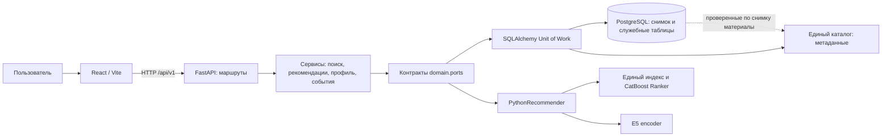
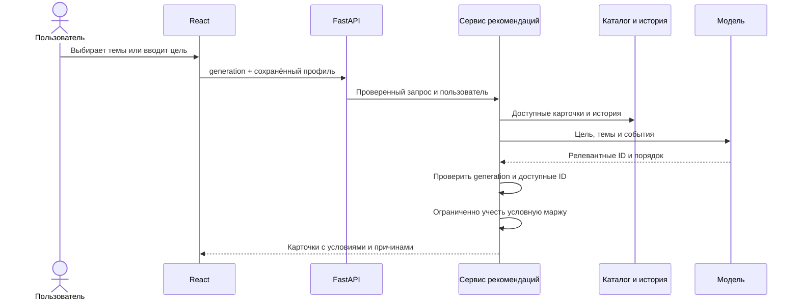
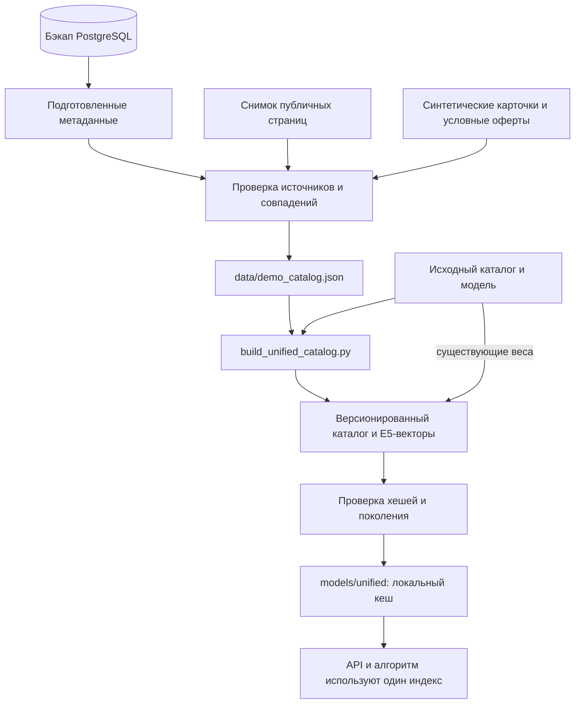
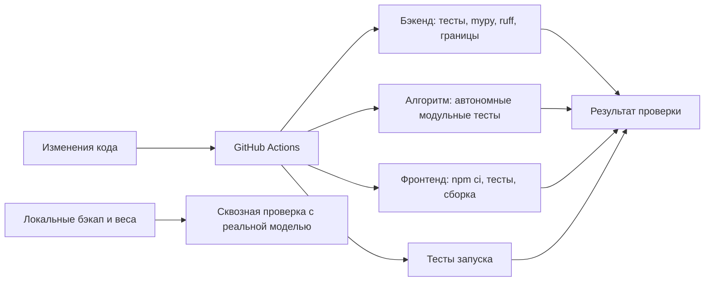

# Архитектура и процессы проекта

Документ описывает основной запуск через `./run.sh`. Отдельные исследовательские
скрипты и прежний автономный интерфейс хранятся для воспроизводимости экспериментов
и не подключаются к основному приложению.

## Компоненты



Зависимости кода направлены внутрь: `domain` содержит сущности и контракты;
`services` реализует сценарии через контракты; `repositories` и `infrastructure`
реализуют адаптеры; `api` преобразует HTTP-запросы; `app.py` связывает компоненты.
Границы проверяются `backend/tests/test_architecture.py`. Транзакция ограничена
одним запросом и откатывается при ошибке. ML загружается один раз на процесс;
входы к нему сериализуются из-за внутренних изменяемых кешей.

## Путь запроса



Модель не является источником прав, актуальных цен или подтверждения покупки.
Бэкенд возвращает данные только по своим допустимым карточкам. Информационная
карточка публичного источника или синтетики имеет `access_verified=false`;
её просмотр не означает доступа к учебному материалу. События `started` и
`completed` принимаются только для курсов с подтверждённым по каталогу доступом;
они по-прежнему являются самоотчётом, а не сертификатом. Историческая запись
бэкапа без разрешения базового каталога не выводится.

## Подготовка данных и индекса



Поля источника, условной цены и себестоимости хранятся отдельно от подтверждённых
полей бэкенда. Совпадение только по названию не переносит условия и историю между
материалами: доступный материал бэкапа сохраняется без публичных дополнений, а
само неподтверждённое совпадение под его ID не показывается. Векторы пересобираются; E5 и CatBoost не переобучаются
при обычном запуске. Отпечаток сборки включает исходные карточки, скрипты,
манифест и веса ранжировщика. При смене исходного комплекта runtime-копия
обновляется с откатом при неудаче; `models/unified/` заново создаётся локально и
исключён из Git. Обновление может потребовать дополнительное место на диске.

## Проверки и поставка



Конфигурация CI — [ci.yml](../.github/workflows/ci.yml). Она не получает бэкап,
данные пользователей или большие веса и поэтому не заменяет проверку реального
ML и PostgreSQL. Версии Python-зависимостей бэкенда зафиксированы в `uv.lock`,
фронтенда — в `package-lock.json`.

Локальная проверка реальной модели запускается после подготовки проекта:

```bash
cd integrated
HF_HUB_OFFLINE=1 TRANSFORMERS_OFFLINE=1 \
  PYTHONPATH=backend:05_code/src .venv/bin/python scripts/smoke_unified.py
```

Тест создаёт отдельную временную SQLite-базу и не меняет PostgreSQL. Проверку
фактического эффекта на продажи и удержание нужно проводить отдельно по реальным
показам, покупкам, возвратам и A/B-группам. Условная маржа и офлайн-метрики не
являются измерением выручки или вероятностью покупки.
